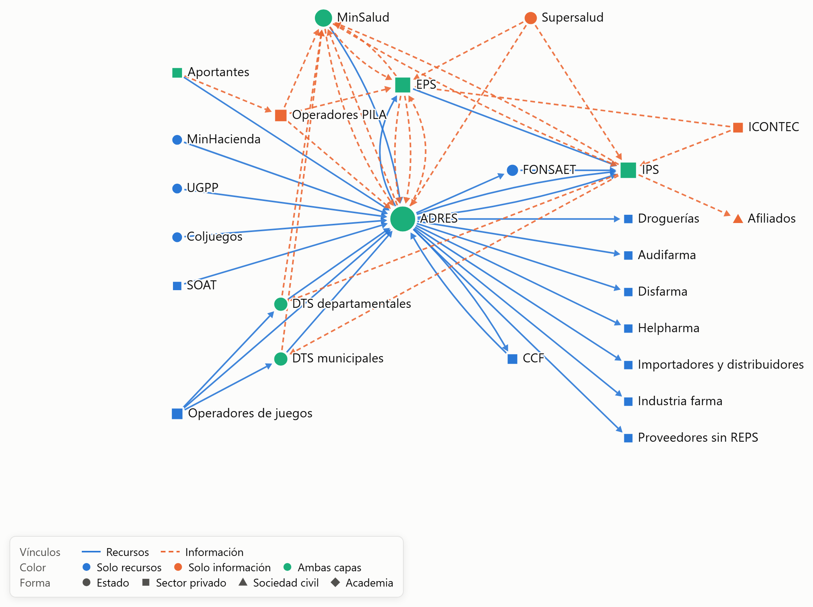

# Red normada

La red normada dibuja los flujos que establecen las normas vigentes entre los actores del sistema de salud colombiano: quién debe enviarle dinero a quién y quién debe enviarle información a quién. Es la red «de derecho», la que se compara con lo que muestran los datos del giro directo.

Tiene 25 actores y 49 vínculos: 26 de recursos (dinero) y 23 de información. Cada vínculo tiene su norma con el artículo.



## Qué hay en la carpeta

| Archivo | Qué es |
|---|---|
| `aristas-normadas.csv` | Los 49 vínculos, cada uno con su norma. Es la entrada principal. |
| `posiciones-normada.csv` | Dónde se dibuja cada actor en el visor, de izquierda a derecha en el sentido del dinero. |
| `construir-red-normada.py` | Une los vínculos con el inventario de actores, comprueba que todo cuadre y genera las salidas y el visor. |
| `plantilla-visor.html` | El visor vacío: el programa le pega los datos. |
| `visor-red-normada.html` | El visor interactivo, ya con los datos. Se abre en cualquier navegador y no necesita internet. |
| `salida/nodos-red-normada.csv` | Los actores del inventario con su papel en la red. |
| `salida/aristas-red-normada.csv` | Los vínculos tal como quedaron después de las comprobaciones. |
| `red-normada.png` | Imagen fija de la red, tomada del visor. |

## Cómo se construyó

1. **Actores.** Salen del inventario de actores (carpeta `../inventario-actores/`), en su nivel base: cada clase de actor es un nodo. Por ejemplo, «EPS» es un solo nodo y no 25. Así la red normada habla de papeles, no de entidades una por una.
2. **Vínculos.** Un vínculo entra solo si una norma lo establece y esa norma se leyó en su fuente oficial: la Secretaría del Senado para las leyes, el Gestor Normativo de la Función Pública para los decretos y el Ministerio de Salud para las resoluciones. Cuando una norma cambió, se usa el texto vigente; por ejemplo, el Decreto 780 de 2016 se leyó en su versión compilada, con sus modificaciones.
3. **Dos capas.** Cada vínculo es de recursos (dinero) o de información (reportes, reglas, vigilancia, planillas).
4. **Lo que queda por fuera.** Si ninguna norma conecta a dos actores, no hay vínculo, aunque el actor sea importante en la práctica. Los contratos entre EPS y prestadores, por ejemplo, entran como un solo vínculo general («pago contractual»), porque la norma no dice con quién contrata cada EPS. Los actores del inventario sin ningún vínculo aparecen en el visor en una cuadrícula aparte.
5. **Observabilidad.** Cada vínculo dice si se puede ver con datos públicos:
   - **observable**: un dato abierto lo registra pareja por pareja (16 vínculos), como el giro directo en los anexos de *Lupa al Giro* de la ADRES;
   - **parcial**: solo hay cifras agregadas (5 vínculos);
   - **no observable**: no hay dato público (28 vínculos).

## Columnas de `aristas-normadas.csv`

| Columna | Qué guarda |
|---|---|
| `id` | Código del vínculo: R para recursos e I para información. Los números no son consecutivos porque un código no se reutiliza. |
| `origen`, `destino` | Los actores que une, con su código del inventario (`ASC-###`). El sentido va de quien envía a quien recibe. |
| `capa` | recursos o informacion. |
| `tipo` | Nombre corto del flujo, por ejemplo «Giro directo de la UPC». |
| `descripcion` | Qué fluye y en qué condiciones, en una o dos líneas. |
| `norma` | La norma con su artículo. |
| `observabilidad` | observable, parcial o no observable. |
| `nota` | Aclaraciones: de dónde salen los datos que lo muestran o qué cuidado tener al leerlo. |

`salida/nodos-red-normada.csv` trae, para cada actor, sus datos del inventario y su papel en la red: si está en la red (`en_red`), en qué capas participa, cuántos vínculos normados tiene (`grado_doc`), si en cada capa emite, recibe o hace las dos cosas, y su posición en el visor.

## Qué muestra

- La norma pone a la ADRES en el centro: tiene 29 de los 49 vínculos.
- Casi todas las fuentes de dinero llegan directo a la ADRES. Las cotizaciones entran por la planilla PILA a cuentas cuya titular es la ADRES; el SGP de los territorios lo gira el Ministerio de Salud; las loterías, el chance y Coljuegos giran directo la parte del régimen subsidiado.
- El dinero y la información viajan por canales distintos. El operador de la PILA maneja la planilla y el banco mueve el dinero; los dos se juntan en la ADRES.
- La ADRES gira por cuenta de las EPS a prestadores, droguerías, importadores, fabricantes y proveedores sin inscripción en el REPS.

## Cómo usarla

**Ver la red.** Abrir `visor-red-normada.html` en un navegador. Se puede:
- filtrar por capa, por tipo de flujo y por observabilidad;
- resaltar a los actores por grupo, sector o tamaño;
- hacer clic en un actor para ver sus datos y sus vínculos;
- ver la tabla completa de vínculos, con la norma de cada uno.

**Reconstruirla.** Se necesita Python 3.12 o más reciente y la librería networkx, en la versión de `requirements.txt`. Se instala desde la raíz del repositorio con `pip install -r requirements.txt`. Después, desde esta carpeta:

```
python construir-red-normada.py
```

El programa lee el inventario en `../inventario-actores/`. Para agregar o corregir un vínculo se edita `aristas-normadas.csv`, con su norma y artículo, y se vuelve a correr. Si el vínculo trae un actor nuevo, ese actor tiene que estar en el inventario y necesita su posición en `posiciones-normada.csv`. El programa se detiene con un mensaje si algo no cuadra.

## Normas citadas

Leyes 100 de 1993, 643 de 2001, 1122 de 2007, 1438 de 2011, 1751 de 2015, 1753 de 2015 y 2294 de 2023. Decretos 1465 de 2005, 780 de 2016, 1437 de 2021, 489 de 2024 y 930 de 2026. Resoluciones del Ministerio de Salud 2082 de 2014, 1587, 2388 y 4621 de 2016, 3110 y 5095 de 2018, 3100 de 2019 y 488 de 2026. La columna `norma` de cada vínculo dice qué artículo lo sostiene.

## Licencia

Ningún archivo de esta carpeta tiene restricción comercial. Los datos, el visor y la imagen se publican con la licencia Creative Commons Atribución-CompartirIgual 4.0 (archivo `LICENSE-DATOS` en la raíz del repositorio). El programa y la plantilla del visor, con la licencia MIT (archivo `LICENSE`). El detalle de todo el repositorio está en [`LICENCIAS.md`](../LICENCIAS.md).
