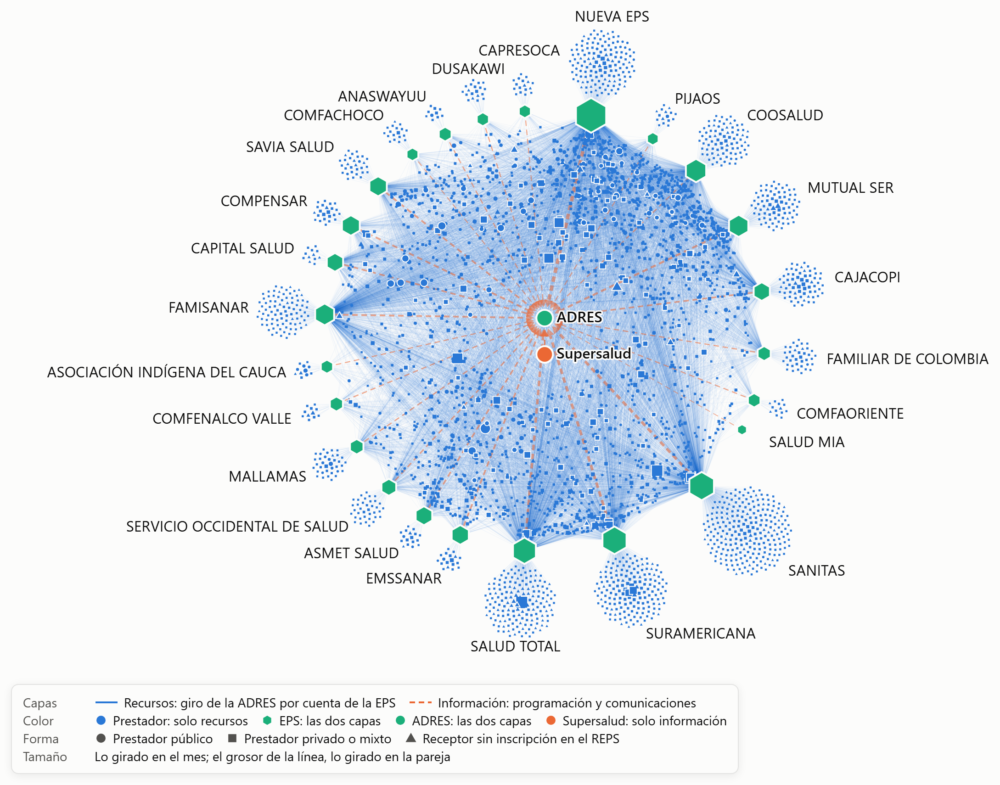

# Red observada

La red observada dibuja el giro directo tal como ocurrió: qué EPS ordenó pagos a qué prestadores y cuánto dinero pasó por cada relación. Es la red «de hecho», que se compara con la red normada (la que establecen las normas, en `../red-normada/`).

Se construye con los anexos mensuales que publica la ADRES en *Lupa al Giro*. El mes que se analiza es septiembre de 2026, y junio, julio y agosto de 2026 sirven de control para ver si los resultados dependen del mes elegido.

En septiembre de 2026 la red tiene 25 EPS, 3.810 prestadores y 12.532 relaciones, por las que la ADRES giró $7,58 billones por cuenta de las EPS.



## Cómo se lee la red

- Es una red **bipartita**: hay dos tipos de nodo, EPS y prestadores, y las relaciones solo van de una EPS a un prestador.
- Una relación existe si en el mes la ADRES le giró dinero a ese prestador por cuenta de esa EPS. Su peso es lo girado, sumando el proceso ordinario y el complemento y los dos regímenes.
- La ADRES no es un nodo de esta red: es quien ejecuta todos los pagos. Aparece en el visor en el centro, junto con la Supersalud, en la capa de información.
- Cada prestador se identifica por su NIT. Los que no tienen NIT de empresa (nueve dígitos que empiezan en 8 o 9) pueden ser personas naturales y se juntan en un solo nodo, `PN-AGREGADO`.

## Qué hay en la carpeta

Los programas, en el orden en que se corren:

| Paso | Programa | Qué hace |
|---|---|---|
| 1 | `descargar-anexos-giro.py` | Baja los anexos de *Lupa al Giro* a `datos/anexos/` y anota en un manifiesto la huella de cada archivo. |
| 2 | `ingerir-anexos-giro.py` | Lee los anexos sin modificarlos y arma la tabla de relaciones. Revisa cada hoja y se detiene si el formato cambia. |
| 3 | `clasificar-prestadores.py` | Le pone a cada prestador su clase, naturaleza jurídica y departamento según el REPS. |
| 4 | `describir-red-observada.py` | Tamaño y concentración de cada mes, y comparación con las cifras del Boletín 72 de la ADRES. |
| 5 | `metricas-red-observada.py` | Arma la red de cada mes y calcula grado, fuerza, dependencia, aristas puente e intermediación. |
| 6 | `variables-capa-informacion.py` | Porcentaje de giro directo de cada EPS, complementos y retenciones del giro. |
| 7 | `verificar-metodos.py` | Prueba los métodos de `redes_metodos.py` con casos de respuesta conocida. |
| 8 | `teoria-redes-observada.py` | Centralidad, concentración, relación fuerza–grado, asortatividad, comunidades y estabilidad entre meses. |
| 9 | `contraste-y-acoplamiento.py` | Compara con la red normada y mide cuánto de la red de recursos depende de la capa de información. |
| 10 | `proyecciones-y-comparacion.py` | Proyecciones EPS–EPS y prestador–prestador, densidad sobre las mismas clases que la norma y lo que entra y sale de cada actor. |
| 11 | `figuras-teoria-redes.py` | Figuras del análisis. |
| 12 | `construir-visor-observada.py` | Genera el visor interactivo. |

Otros archivos:

| Archivo | Qué es |
|---|---|
| `correr-todo.py` | Corre los doce pasos en orden. |
| `configuracion.py` | El mes que se analiza, los meses de control, las carpetas que usan los programas y la forma de escribir los `.csv.gz`, sin fecha, para que volver a correr dé los mismos archivos. |
| `redes_metodos.py` | Los métodos de redes que NetworkX no trae (modularidad bipartita, comparación de particiones, Gini, entre otros). |
| `plantilla-visor-observada.html` | El visor vacío: el paso 12 le pega los datos. |
| `visor-red-observada.html` | El visor ya con los datos. Se abre en cualquier navegador y no necesita internet. |
| `datos/reps/` | El extracto del REPS que se usó, con su manifiesto. |
| `salida/` | Todo lo que calculan los programas (ver abajo). |
| `red-observada.png` | Imagen fija de la red, tomada del visor. |

## Cómo se construyó

1. **Descarga.** Los anexos son archivos de Excel que la ADRES publica cada mes en tres series: giro directo del contributivo, giro directo del subsidiado por prestador y giro del subsidiado por EPS. Se bajaron los cortes de enero de 2024 a octubre de 2026: 101 archivos.
2. **Lectura.** Cada fila de un anexo es una operación. Una relación es la pareja EPS–prestador dentro del mes; su peso es la suma de sus operaciones. Se conservan las operaciones con giro en cero o con lo ordenado distinto de lo girado, porque dicen algo sobre el proceso. Cuando el anexo trae mal el código de una EPS, se corrige solo si el nombre de la misma fila corresponde sin duda a otro código; cada corrección queda registrada.
3. **Comprobaciones.** La suma de las relaciones se comparó con la certificación del giro del subsidiado, EPS por EPS y mes por mes: en el proceso ordinario cuadran 900 de 903 casos. También se reprodujeron las cifras del Boletín 72 de *Lupa al Giro* (junio de 2026).
4. **Clasificación.** Cada NIT se cruzó con el REPS para saber si es ESE, IPS pública, privada o mixta, y en qué departamento está. Los receptores que no están en el REPS se cruzaron con el inventario de actores (`../inventario-actores/`) para identificar a los gestores farmacéuticos.
5. **Análisis.** Todo es descriptivo: se mide la estructura de la red, no se estiman causas.
6. **Comparación con la norma.** Los prestadores se agrupan en las clases de actor que usa la red normada (IPS, droguerías y gestores farmacéuticos, cajas de compensación, importadores, industria y proveedores sin inscripción en el REPS). Así las dos redes se comparan sobre los mismos nodos.

## Qué muestra (septiembre de 2026)

- **Pocas EPS concentran la mayor parte del dinero.** Por cuenta de las cuatro más grandes (Nueva EPS, Sanitas, Suramericana y Salud Total) se gira el 58,6 %.
- **Muchos prestadores dependen de una sola EPS.** El 35,4 % recibe giro por cuenta de una sola EPS y el 85,2 % recibe por cuenta de una sola EPS al menos la mitad de lo que le llega por giro directo.
- **El dinero crece más rápido que el número de EPS.** Lo que recibe un prestador crece, en promedio, como su número de EPS elevado a 1,60: tener el doble de EPS se asocia con recibir unas tres veces más.
- **Los prestadores con pocas EPS suelen estar con las EPS grandes.** La asortatividad es de −0,15: en las relaciones, las EPS con muchos prestadores tienden a unirse con prestadores que reciben de pocas EPS. En parte se sigue de lo desiguales que son los tamaños de las EPS.
- **La red pública recibe una parte menor del subsidiado.** El 36,1 % del giro directo del régimen subsidiado llega a empresas sociales del Estado (ESE). La Ley 1122 de 2007 pide contratar al menos el 60 % del gasto con ESE; la comparación es solo orientativa, porque el giro no es todo el gasto contratado.
- **Lo que pasa coincide con lo que la norma permite.** Todo el dinero llega a clases de actor que tienen un vínculo normado, pero cada EPS usa solo una parte de las clases que la norma habilita (96 de 225 parejas EPS–clase).
- **Casos para mirar de cerca.** 37 anomalías: 15 prestadores que reciben mucho más de lo que su número de EPS haría esperar y 22 relaciones ordenadas que no se giraron. Una anomalía señala dónde mirar; no es una irregularidad.

## Cómo usarla

**Ver la red.** Abrir `visor-red-observada.html` en un navegador. Se puede:
- cambiar de mes;
- mostrar u ocultar la capa de recursos y la de información;
- filtrar por tipo de prestador y por departamento, y colorear por dependencia de la EPS principal;
- buscar una EPS, un prestador o un NIT, y hacer clic en cualquiera para ver sus datos;
- ver lo resaltado como tabla.

**Volver a correr todo.** Se necesita Python 3.12 o más reciente y las librerías de `requirements.txt`, que trae las versiones con que se probó. Con ellas, los resultados salen iguales a los publicados. Se instalan desde la raíz del repositorio:

```
pip install -r requirements.txt
```

Después, desde esta carpeta:

```
python correr-todo.py
```

El primer paso baja los anexos de la ADRES (unos 36 MB). Si un archivo ya está en el manifiesto, el programa comprueba que lo bajado sea igual al que se usó; si la ADRES lo cambió, lo guarda aparte y avisa que los resultados pueden ser distintos. Si la ADRES ya no lista en su página un anexo del manifiesto, el programa lo baja de la dirección que guarda el manifiesto y hace la misma comprobación. Sin contar la descarga, todo el proceso tarda unos cuatro minutos. Opciones:

- `--sin-descarga`: usa los anexos que ya están en `datos/anexos/`;
- `--reps-nuevo`: baja un extracto nuevo del REPS. Sin esta opción se usa el extracto guardado en `datos/reps/`, para que los resultados no cambien de una corrida a otra;
- `--desde N`: empieza en el paso N, por ejemplo después de cambiar solo el análisis.

**Analizar otro mes.** Cambiar `PRINCIPAL` y `CONTROL` en `configuracion.py` y volver a correr `correr-todo.py`. Si el mes es nuevo, el primer paso lo baja.

**Usar los datos desde otra carpeta.** Crear en esta carpeta un archivo `rutas-locales.json` con las carpetas que cambian, por ejemplo `{"anexos": "D:/datos/lupa-al-giro"}`. Las claves posibles están en `configuracion.py`.

## Salidas principales

| Archivo en `salida/` | Qué guarda |
|---|---|
| `manifiesto-descargas.csv` | Cada anexo bajado: dirección, fecha de descarga, tamaño y huella SHA-256. |
| `relaciones-giro-directo.csv.gz` | Todas las relaciones de enero de 2024 a octubre de 2026: mes, régimen, proceso, EPS, prestador, lo ordenado, lo girado y el número de operaciones. |
| `prestadores-clasificados.csv` | Cada prestador con su clase, naturaleza y departamento según el REPS. |
| `eps-entidades.csv` | Los códigos de EPS de los anexos unidos en entidades (una EPS puede tener un código por régimen). |
| `aristas-red-observada.csv.gz` | Las relaciones del mes principal y de los meses de control, con sus partes. |
| `metricas-eps.csv`, `metricas-prestadores.csv.gz` | Las métricas de cada EPS y de cada prestador, por mes. |
| `variables-eps-mes.csv` | Porcentaje de giro directo, complementos y retenciones de cada EPS, por mes. |
| `teoria-redes/` | Centralidad, concentración, curvas de Lorenz, relación fuerza–grado, asortatividad, comunidades, estabilidad entre meses y las figuras. |
| `contraste/` | La comparación con la red normada, las reglas de la Ley 1122, el acoplamiento entre capas y las anomalías. |
| `proyecciones/` | Las dos proyecciones, la densidad sobre las mismas clases que la norma y lo que entra y sale de cada actor, con sus figuras. |

Cada programa escribe además un resumen en texto (`resumen-*.txt`) con sus cifras principales. Los controles de la lectura están en `esquema-anexos.csv`, `controles-por-hoja.csv`, `correcciones-codigo-eps.csv` y `cotejo-certificacion.csv`.

## Datos personales

Los anexos de la ADRES, tal como se publican, traen algunas operaciones cuyo receptor es una persona natural, con su número de documento y su nombre. Ninguno de esos datos llega al repositorio:

1. **Al bajarlos.** `descargar-anexos-giro.py` guarda los anexos en `datos/anexos/`. El archivo `.gitignore` deja esa carpeta por fuera de git, así que no se pueden subir por error. Quien los baje los tiene en su computador y no debe publicarlos.
2. **Al leerlos.** `ingerir-anexos-giro.py` trata como NIT de empresa solo la identificación de nueve dígitos que empieza en 8 o 9. Cualquier otra se suma en un nodo colectivo, `PN-AGREGADO` («Personas naturales (agregado)»). El número y el nombre se descartan en ese momento: no se guardan en ninguna salida y el programa no los imprime.
3. **En las salidas.** Las personas naturales solo aparecen como `PN-AGREGADO`, sin número, nombre ni ubicación. Los anexos originales no se incluyen: el manifiesto guarda la huella de cada uno, para que quien los vuelva a bajar compruebe que tiene los mismos archivos.

Además:

- La copia del REPS de `datos/reps/` deja por fuera, por la misma razón, 23 filas. Esas filas no cambian ningún resultado. Las descargas nuevas del REPS aplican el mismo filtro.
- Ningún archivo del repositorio, ni en sus versiones anteriores, trae el número, el nombre o los datos de contacto de una persona natural. Se comprobó sobre todas las tablas y todo el historial del repositorio.

## Limitaciones

- El giro directo no es todo lo que recibe un prestador: también cobra a la EPS por fuera del giro y a otros pagadores. La dependencia se mide sobre el giro directo.
- Solo se mide el giro directo de la UPC. Otros recursos, como los presupuestos máximos, no están en esta red.
- Las comunidades salen de métodos que buscan la mejor partición sin garantía de encontrarla. Por eso se fijan las semillas y se comparan varias particiones.
- La clase de cada prestador depende de cómo está inscrito en el REPS en la fecha del extracto (12 de marzo de 2026).

## Fuentes

- ADRES, *Lupa al Giro*, módulos del régimen contributivo y del régimen subsidiado: anexos mensuales del giro directo, de enero de 2024 a octubre de 2026. La dirección de cada archivo está en `salida/manifiesto-descargas.csv`.
- Ministerio de Salud y Protección Social, Registro Especial de Prestadores y Sedes (REPS), conjunto `c36g-9fc2` de datos.gov.co, publicado con licencia Creative Commons Atribución-CompartirIgual 4.0. Extracto del 20 de octubre de 2026 (corte del REPS del 12 de marzo de 2026).
- Inventario de actores y red normada de este repositorio.

## Licencia

Esta es la única carpeta del repositorio con archivos que tienen restricción comercial.

| Archivos | Licencia | ¿Permite uso comercial? |
|---|---|---|
| `salida/` (todas las salidas y figuras), `visor-red-observada.html` y `red-observada.png` | Creative Commons Atribución-NoComercial-CompartirIgual 4.0 (archivo `LICENSE-DATOS-NO-COMERCIAL` en la raíz) | No, salvo autorización previa de la ADRES |
| `datos/reps/`, la copia del REPS | Creative Commons Atribución-CompartirIgual 4.0, la del REPS (archivo `LICENSE-DATOS`) | Sí |
| Los programas (`.py`) y `plantilla-visor-observada.html` | MIT (archivo `LICENSE`) | Sí |
| Este README | Creative Commons Atribución-CompartirIgual 4.0 (archivo `LICENSE-DATOS`) | Sí |

- **Por qué hay restricción.** Las salidas, el visor y la imagen se derivan de los anexos de la ADRES. Los términos de uso de su sitio prohíben usar o transformar sus contenidos con fines comerciales sin su autorización previa, y piden mencionar que el contenido es de la ADRES. Se pueden usar y transformar sin fines comerciales, citando a la ADRES como fuente y compartiendo lo derivado con la misma licencia.
- **Datos del REPS en las salidas.** Las salidas también traen datos de hecho del REPS sobre cada prestador: clase, naturaleza jurídica, si es ESE, departamento, municipio y código. Quien los necesite sin la restricción comercial los toma de la copia de `datos/reps/`. Por qué pueden ir en archivos no comerciales está explicado en [`LICENCIAS.md`](../LICENCIAS.md).
